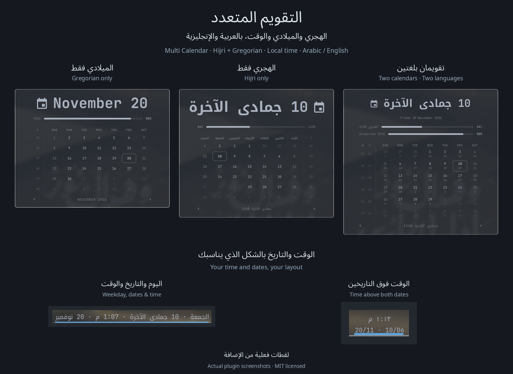
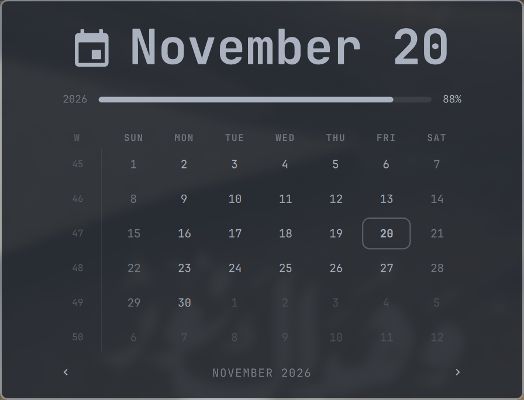
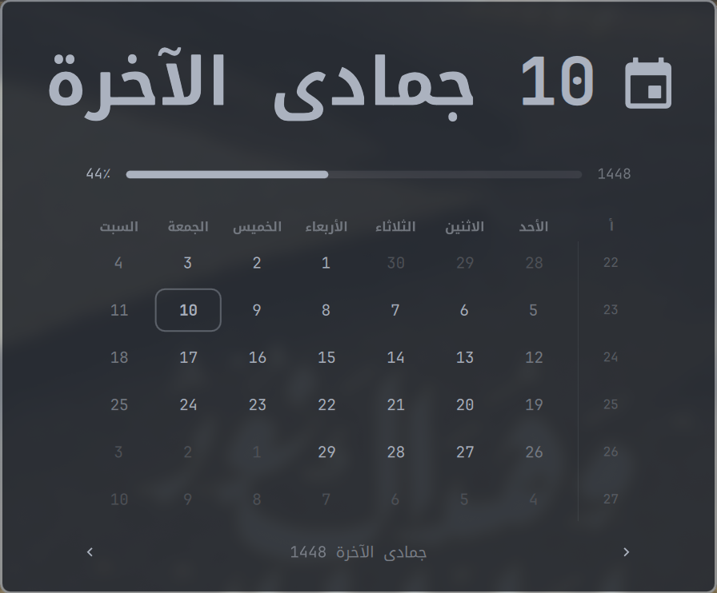
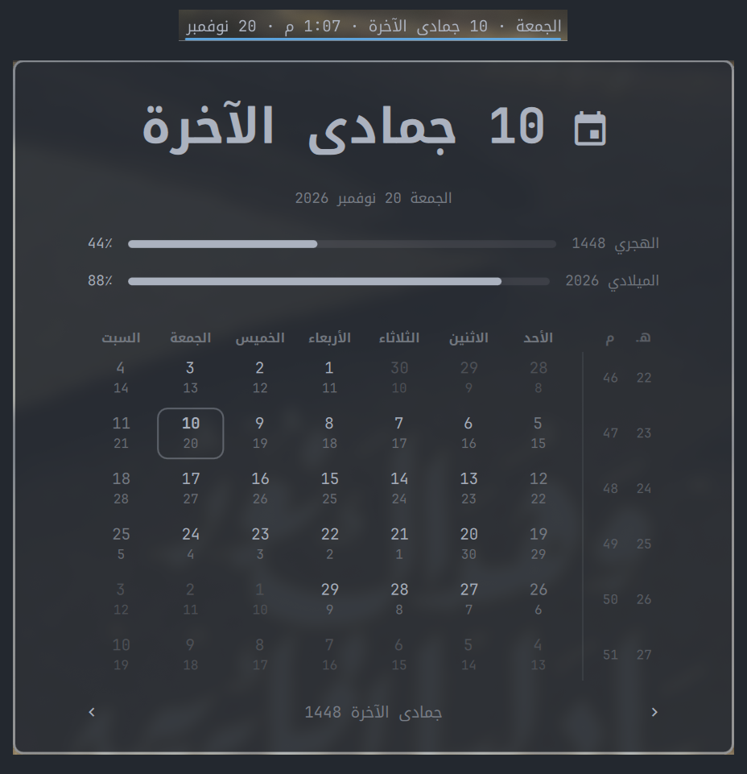
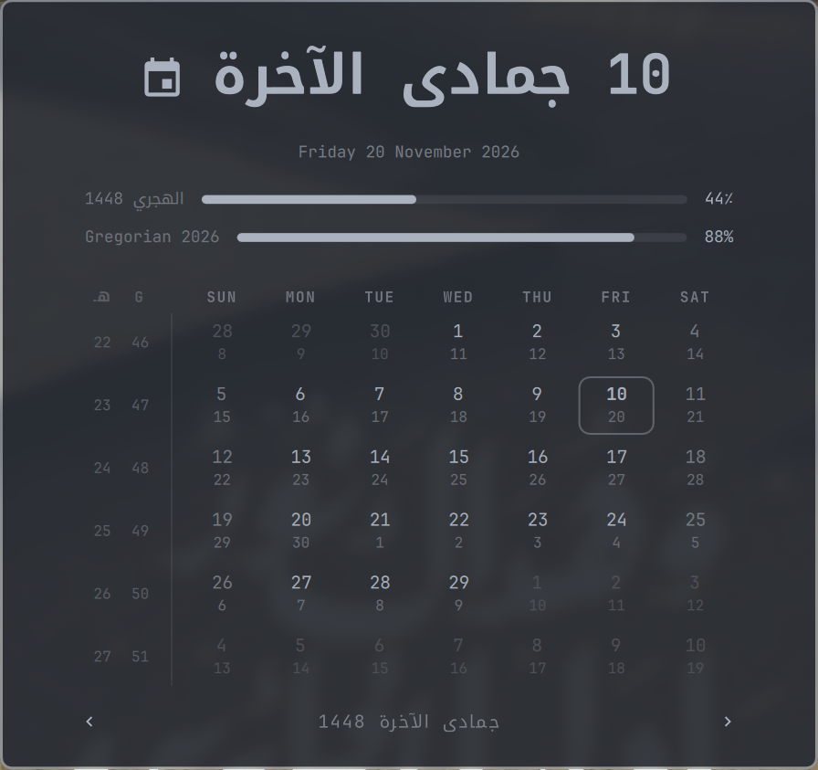
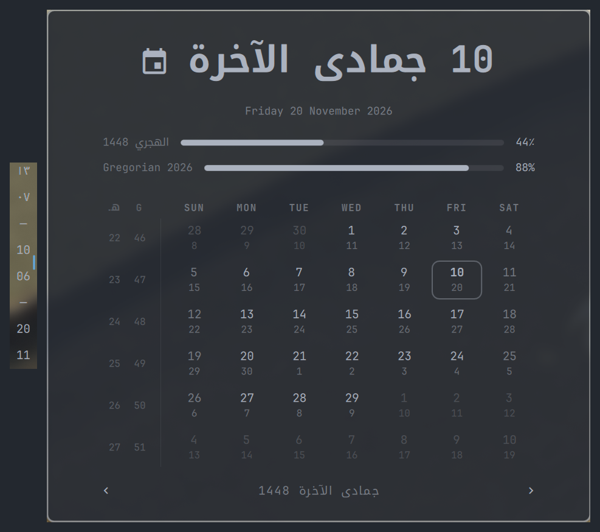
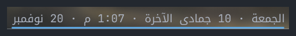
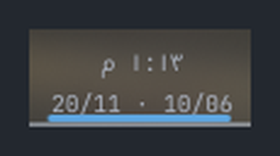

# Multi Calendar · التقويم المتعدد

[العربية](#العربية) · [English](#english)



<details>
<summary>المزيد من لقطات الشاشة · More screenshots</summary>

| Gregorian only · الميلادي فقط | Hijri only · الهجري فقط | Both calendars · التقويمان معًا |
| --- | --- | --- |
|  |  |  |

| Mixed languages · لغتان | Sidebar · الشريط الجانبي |
| --- | --- |
|  |  |

| One line · سطر واحد | Time above both dates · الوقت فوق التاريخين |
| --- | --- |
|  |  |

</details>

## العربية

إضافة لشريط Omarchy تعرض الوقت وتقويمًا واحدًا أو تقويمين معًا.

- التقويم الهجري بأم القرى والتقويم الميلادي.
- لغة وأرقام وأرقام أسابيع وشريط تقدّم السنة لكل تقويم.
- تعمل دون إنترنت، وتتبع سمة النظام.

### التثبيت

```sh
omarchy plugin add https://github.com/ThabetFY/omarchy-multi-calendar.git --enable
```

اختر مكان الإضافة في الشريط عند سؤالك.

### إظهار الهجري والوقت والميلادي

```sh
omarchy bar set thabetfy.multi-calendar calendars '[{"id":"hijri","provider":"islamic-umalqura","digits":"latin"},{"id":"gregorian","provider":"gregorian","digits":"latin"}]' --json
omarchy bar set thabetfy.multi-calendar primaryCalendar hijri
omarchy bar set thabetfy.multi-calendar format '{hijri:ddd} · {hijri:dd MMMM} · {time:h:mm AP} · {gregorian:dd MMMM}'
```

للتوقيت بنظام 24 ساعة، استبدل `h:mm AP` بـ `HH:mm`.

خيارات أخرى في [جدول التنسيقات](#format-examples).

### الاستخدام

النقر الأيسر يفتح التقويم. النقر الأيمن يغيّر تنسيق الشريط. الأسهم وعجلة الفأرة تنقل بين الشهور، و`T` يعيدك إلى اليوم.

الإعدادات في `~/.config/omarchy/shell.json`، وليست داخل النافذة. راجع [دليل الإعدادات](docs/configuration.md).

### ملاحظات

- جُرّبت على Omarchy 4.5.0.
- نطاق الهجري: 1343–1500 هـ. قد تختلف المناسبات الدينية حسب الرؤية المحلية.
- تعمل بصلاحيات مستخدمك دون عزل أمني.

---

## English

An Omarchy bar widget for local time and one or two calendars.

- Gregorian and Umm al-Qura Hijri calendars.
- Separate language, digits, week numbers and year progress for each calendar.
- Works offline and follows your desktop theme.

### Install

```sh
omarchy plugin add https://github.com/ThabetFY/omarchy-multi-calendar.git --enable
```

Choose where you want it on the bar when asked.

### Show Hijri, time and Gregorian together

```sh
omarchy bar set thabetfy.multi-calendar calendars '[{"id":"hijri","provider":"islamic-umalqura","digits":"latin"},{"id":"gregorian","provider":"gregorian","digits":"latin"}]' --json
omarchy bar set thabetfy.multi-calendar primaryCalendar hijri
omarchy bar set thabetfy.multi-calendar format '{hijri:ddd} · {hijri:dd MMMM} · {time:h:mm AP} · {gregorian:dd MMMM}'
```

For 24-hour time, replace `h:mm AP` with `HH:mm`.

More options in the [format table](#format-examples).

### Use

Left-click opens the calendar. Right-click changes the bar format. Use the arrows or mouse wheel to browse months, and `T` to return to today.

Settings live in `~/.config/omarchy/shell.json`, not in the popup. See the [configuration guide](docs/configuration.md).

### Notes

- Tested on Omarchy 4.5.0.
- Hijri range: 1343–1500 AH. Religious observance may differ with local moon sighting.
- Runs with your user permissions, without sandboxing.

<a id="format-examples"></a>

## Format examples · أمثلة التنسيقات

ضع النمط في `format` للأفقي أو `verticalFormat` للجانبي. لغة الناتج وأرقامه حسب إعداداتك.

Set `format` for a horizontal bar or `verticalFormat` for a sidebar. Output follows your language and digit settings.

مثال / Sample: **19 November 2026 / 9 Jumada al-Akhirah 1448, 13:05:09** — English names, Latin digits.

| View · العرض | Pattern · النمط | Example · مثال |
| --- | --- | --- |
| Hijri date · التاريخ الهجري | `{hijri:dd/MM/yyyy}` | `09/06/1448` |
| Gregorian date · التاريخ الميلادي | `{gregorian:dd/MM/yyyy}` | `19/11/2026` |
| Full Hijri date · الهجري كاملًا | `{hijri:dddd d MMMM yyyy}` | `Thursday 9 Jumada al-Akhirah 1448` |
| 24-hour time · الوقت بنظام 24 ساعة | `{time:HH:mm}` | `13:05` |
| 12-hour time · الوقت بنظام 12 ساعة | `{time:h:mm AP}` | `1:05 PM` |
| With seconds · مع الثواني | `{time:HH:mm:ss}` | `13:05:09` |
| Both dates · التاريخان | `{hijri:dd/MM} · {gregorian:dd/MM}` | `09/06 · 19/11` |
| Dates and time · التاريخان والوقت | `{hijri:dd/MM} · {time:h:mm AP} · {gregorian:dd/MM}` | `09/06 · 1:05 PM · 19/11` |
| Time above dates · الوقت فوق التاريخين | `{time:h:mm AP}\n{hijri:dd/MM} · {gregorian:dd/MM}` | `1:05 PM`<br>`09/06 · 19/11` |
| Sidebar time · وقت الشريط الجانبي | `{time:HH\nmm}` | `13`<br>`05` |
| Sidebar date · تاريخ الشريط الجانبي | `{hijri:dd\nMM\nyyyy}` | `09`<br>`06`<br>`1448` |

اكتب `\n` داخل نص JSON لإنشاء سطر جديد. يجب أن تطابق الأسماء `hijri` و`gregorian` معرّفات التقويمات المختارة لديك.

Use `\n` inside a JSON string for a new line. `hijri` and `gregorian` must match your selected calendar IDs. See [all tokens and built-in presets · جميع الرموز والتنسيقات الجاهزة](docs/configuration.md#format-reference).

## Update or remove · التحديث أو الإزالة

```sh
omarchy plugin update thabetfy.multi-calendar
omarchy plugin remove thabetfy.multi-calendar
```

## Credits · الأصل والترخيص

Based on [Omarchy's clock](https://github.com/basecamp/omarchy), by David Heinemeier Hansson and contributors. Customizations by [ThabetFY](https://github.com/ThabetFY).

بيانات أم القرى / Umm al-Qura data: [hijridate](https://github.com/dralshehri/hijridate), by Mohammed Alshehri.

الترخيص والنسب / License and attribution: [MIT](LICENSE) · [NOTICE](NOTICE).

للمساهمة / To contribute: [CONTRIBUTING.md](CONTRIBUTING.md).
